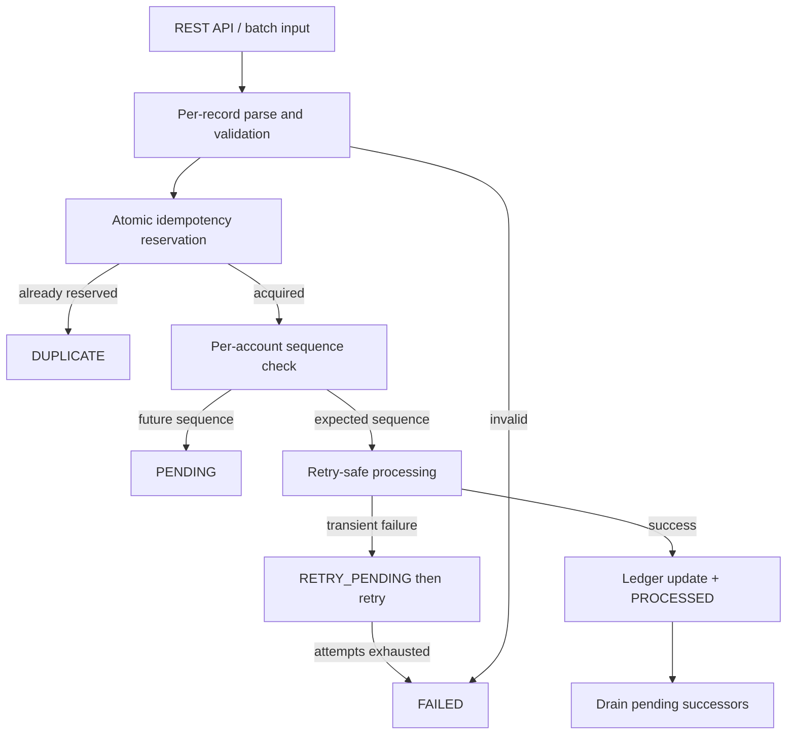

# Emphasis Transaction Processing Service

Idempotent background transaction processing service for an FDE L2 practical assessment.

The service accepts transaction requests that may arrive duplicated, out of order, or retried after transient failure. It applies each unique business transaction at most once, isolates invalid records, and exposes a processing summary.

## 1. Overview

`emphasis-transaction-processing-service` is a Spring Boot 3 application that simulates a production-style background processor behind a small REST API.

It is intentionally lightweight: persistence is in-memory, there is no UI, and there is no Kafka/AWS/database infrastructure. The design is still production-aware: atomic reservation for idempotency, sequence-based ordering, retry-safe side effects, structured logs, and a documented path to durable deployment.

## 2. Problem Statement

Upstream systems, files, schedulers, and retrying clients deliver transaction requests asynchronously. Those requests can:

- arrive more than once
- arrive with a different `requestId` for the same business `transactionId`
- arrive before earlier sequence numbers for an account
- fail transiently and be retried
- contain malformed fields

The processor must not apply duplicate balance updates, must not process future sequences early, must retry without repeating side effects, and must not let one bad record stop the batch.

## 3. Goals

- Process each unique `transactionId` at most once
- Detect duplicates even later in a batch
- Hold out-of-order work in `PENDING` and release it when the gap fills
- Retry simulated transient failures without duplicate ledger updates
- Isolate invalid records as `FAILED`
- Expose lookup, summary, and health endpoints
- Keep the design explainable in an interview

## 4. Architecture



Layering:

```
Controller
    -> TransactionProcessingService
        -> Validator / IdempotencyService / OrderingService / Ledger / FailureSimulator
            -> TransactionRepository / AccountBalanceRepository
                -> In-memory ConcurrentHashMap implementations
```

Controllers stay thin. Business rules live in services. Repositories are interfaces so a database implementation can replace the in-memory store later.

## 5. Technology Stack

- Java 21
- Spring Boot 3.3
- Maven
- Spring Web
- Bean Validation (explicit validator for per-record isolation)
- Jackson
- SLF4J / Logback
- Spring Boot Actuator (`/actuator/health`)
- JUnit 5, AssertJ, Mockito via `spring-boot-starter-test`
- `BigDecimal` for amounts
- No database, no message broker, no frontend

## 6. Domain Model

`TransactionRequest`

| Field | Role |
| --- | --- |
| `transactionId` | Business identity and idempotency key |
| `requestId` | Delivery / request attempt identity |
| `accountId` | Account whose sequence and balance are updated |
| `transactionType` | `CREDIT`, `DEBIT`, `REVERSAL` |
| `amount` | Positive `BigDecimal` |
| `currency` | 3-character code |
| `sequenceNumber` | Positive integer, scoped per `accountId` |

`TransactionRecord` stores status, retry metadata, and timestamps. Balances are stored separately so duplicate detections cannot mutate the ledger.

## 7. Transaction Lifecycle

```
RECEIVED
  -> DUPLICATE          (identity already reserved)
  -> PENDING            (sequence gap)
  -> FAILED             (validation)
  -> PROCESSING
       -> PROCESSED
       -> RETRY_PENDING -> PROCESSING -> PROCESSED | FAILED
```

`PENDING` exists so a later sequence can be stored without applying a business effect until the account's expected sequence arrives. It is not a failure.

Terminal processing failure after retries does **not** advance the account sequence. Later pending transactions stay pending until the gap is operationally resolved. That is safer for customers than silently skipping a failed sequence.

## 8. Idempotency Strategy

- **Business identity:** `transactionId`. This is the only key that authorizes a ledger update.
- **Request identity:** `requestId`. This identifies a delivery attempt. It is logged and returned, but it cannot bypass business idempotency.
- **Duplicate handling:** a second request with the same `transactionId` returns `DUPLICATE` whether `requestId` is the same or different.
- **Atomic reservation:** `ConcurrentHashMap.putIfAbsent(transactionId, record)` establishes ownership. The caller that inserts the record is the only caller allowed to process it. Checking `containsKey` then processing would race.
- **Business effect protection:** the ledger is updated only after reservation succeeds, the sequence is expected, and the failure simulator allows the attempt. Retries reuse the same reserved record.

Unsafe pattern that this service does **not** use:

```java
if (!map.containsKey(transactionId)) {
    process(); // race: two threads can both pass the check
}
```

## 9. Duplicate Detection

Duplicates are detected at reservation time, including later in the same batch.

Examples:

- `TXN-2001 / REQ-1` then `TXN-2001 / REQ-1` -> second result `DUPLICATE`
- `TXN-2001 / REQ-1` then `TXN-2001 / REQ-2` -> second result `DUPLICATE`, balance unchanged

The stored canonical record keeps the original status (`PROCESSED`, `PENDING`, or `FAILED`). Batch results still report `DUPLICATE` for the later attempt. Global summary `duplicate` is the count of detected duplicate attempts.

## 10. Out-of-Order Strategy

Sequence-based processing, scoped per `accountId`, starting at `1`.

The batch is processed in **arrival order**. It is not sorted.

Example:

1. `TXN-2002` sequence 2 arrives while expected sequence is 1 -> `PENDING`
2. `TXN-2001` sequence 1 arrives -> `PROCESSED`, expected sequence becomes 2
3. Pending `TXN-2002` is released -> `PROCESSED`

If sequence 5 arrives while expected is 3, it stays `PENDING` and the missing sequences are logged.

## 11. Retry Strategy

- Transient failures are simulated deterministically by `FailureSimulator`.
- Default: `TXN-2005` fails on attempt 1, then succeeds.
- `processing.max-retries` is the maximum **attempts** (default 3), including the first try.
- Failed attempts set `RETRY_PENDING` and increment `retryCount`.
- Exhaustion sets `FAILED` with reason `RETRY_EXHAUSTED`.
- The simulated failure happens **before** the ledger update, so a retry cannot double-apply a side effect.
- The same reservation still owns the `transactionId` during retries.

Suggested sample row `TXN-2005` uses `ACC-203` sequence `5`. Under per-account sequencing that record is `PENDING` (missing 1-4) and never reaches the simulator. Tests cover retry with `sequenceNumber=1` on a fresh account. That mismatch is an intentional, documented trade-off: keep the sample data and keep a strict ordering strategy.

## 12. Validation

Rejected before processing, without stopping the batch:

- required `transactionId`, `requestId`, `accountId`, `transactionType`, `amount`, `currency`, `sequenceNumber`
- amount > 0
- currency is a 3-letter code
- sequenceNumber > 0
- type is `CREDIT`, `DEBIT`, or `REVERSAL`

Each malformed JSON object in a batch becomes a `FAILED` result. Malformed HTTP bodies still return HTTP 400.

## 13. Concurrency

Per-`transactionId` ownership uses `putIfAbsent`. Per-`accountId` processing uses a striped lock so sequence checks, ledger updates, and pending drains are consistent for one account.

Two threads submitting `TXN-2001` concurrently produce one `PROCESSED` result, N-1 `DUPLICATE` results, and a single balance update.

In-memory synchronization protects a single JVM. A production multi-instance deployment would require durable idempotency enforcement such as a database unique constraint, transactional update, or equivalent distributed mechanism.

## 14. API Endpoints

| Method | Path | Purpose |
| --- | --- | --- |
| POST | `/api/v1/transactions/batch` | Process an array of requests in arrival order |
| POST | `/api/v1/transactions` | Process one request using the same service |
| GET | `/api/v1/transactions/{transactionId}` | Lookup stored record |
| GET | `/api/v1/transactions/summary` | Status counts, duplicate detections, balances |
| GET | `/actuator/health` | Liveness/health |

Successful batch: HTTP 200 with `results` and `summary`. Transaction-level failures stay in the 200 body as `FAILED`. HTTP 400 is reserved for malformed requests. HTTP 404 is returned when a lookup id is unknown. Stack traces are not exposed.

## 15. Running Locally

Java 21 and Maven 3.6.3+ are required.

```bash
mvn clean test
mvn spring-boot:run
```

If the Maven wrapper is present:

```bash
./mvnw clean test
./mvnw spring-boot:run
```

The API listens on `http://localhost:8080`.

## 16. Sample Request

```bash
curl -s -X POST http://localhost:8080/api/v1/transactions/batch \
  -H 'Content-Type: application/json' \
  -d @sample/transactions.json
```

## 17. Sample Response

See `sample/expected-output.json`.

After the sample batch, `ACC-201` balance is `85` (`100 - 40 + 25`). `TXN-2004` is `FAILED`. `TXN-2005` is `PENDING`.

## 18. Test Coverage

JUnit 5 tests cover:

1. Valid CREDIT
2. Valid DEBIT
3. Duplicate request
4. Duplicate does not update balance twice
5. Same `transactionId` with different `requestId`
6. Out-of-order arrival
7. Pending release when the missing sequence arrives
8. Invalid negative amount
9. Missing required field
10. Invalid record does not stop the batch
11. Retry then success
12. Retry exhaustion -> `FAILED`
13. Retry does not duplicate the effect
14. Concurrent duplicate processing
15. Processing summary counts
16. Transaction lookup
17. REVERSAL behavior
18. REST smoke tests (batch, lookup, summary, health, 400, 404)

Service tests use the real in-memory repositories. Mockito is available but not required for the core path.

## 19. Assumptions

- Sequence numbers are per `accountId` and start at 1.
- Negative balances are allowed; this is not a full banking product.
- `REVERSAL` reverse a CREDIT of the same amount (subtract).
- Validation failures occupy the `transactionId` so a later valid retry of the same id is `DUPLICATE`. Operational correction would use a new id or a dedicated replay tool.
- Failed processing after retry exhaustion does not advance the account sequence.
- In-memory state is lost on restart.
- The input source is HTTP today; the processing service does not depend on HTTP internals except JSON parsing at the API edge.

## 20. Trade-offs

- In-memory store over a database: faster to implement and test; not crash-safe.
- Inline retries over a delayed retry worker: demonstrates retry safety in one request; a production worker would backoff and use a DLQ.
- Strict per-account sequences over sorting the batch: matches the arrival-order requirement; `TXN-2005` in the suggested sample becomes `PENDING`.
- No overdraft rules: keeps the assessment focused on idempotency and ordering.

## 21. Production Hardening

See `docs/production-hardening.md` for database unique constraints, messaging semantics, backoff/DLQ, observability, Kubernetes, security, partitioning, and recovery. Those are documented, not implemented.

## 22. AI-Assisted Development

This repository was built with Cursor Agent assistance during the assessment.

- AI generated the initial project layout, Spring Boot wiring, processing flow, tests, and documentation drafts.
- Generated code was reviewed against the assessment requirements: atomic reservation, no batch sort, retry-before-ledger, per-record isolation, and concurrency.
- The suite was executed with `mvn clean test`. Failures were fixed and re-run.
- APIs were smoke-tested against a running Spring Boot process, including the sample JSON and `/actuator/health`.
- Edge cases that AI drafts often miss — `putIfAbsent` vs `containsKey`, pending drain in the same batch, sequence vs retry on `TXN-2005`, concurrent duplicates — were validated with explicit tests.

AI sped up boilerplate. Design choices, race-condition handling, and sample-data interpretation were treated as engineering decisions, not accepted blindly.
