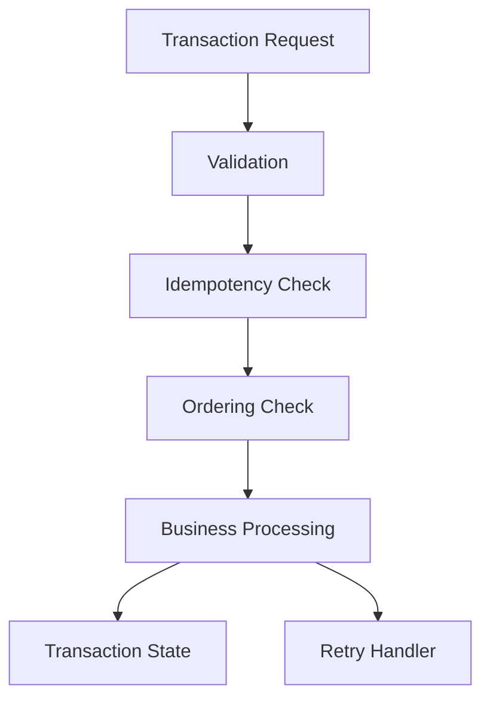
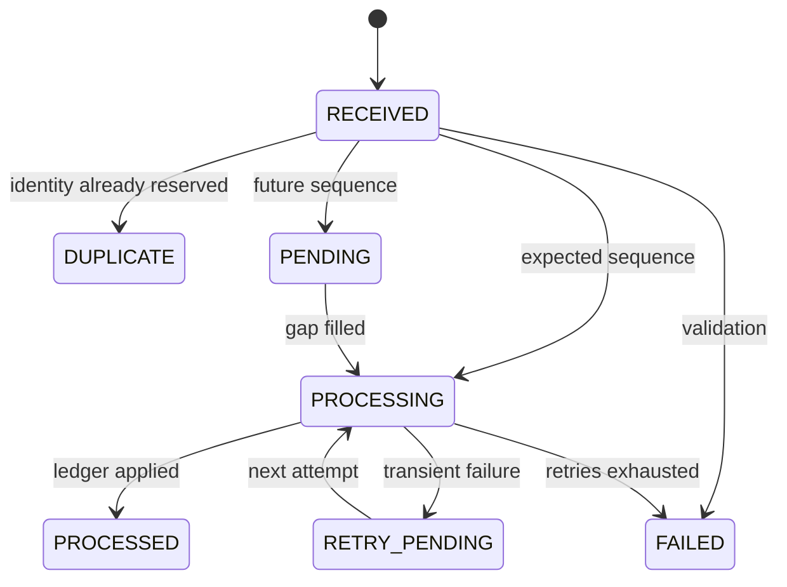

# Architecture

## 1. Problem

Enterprise platforms receive transaction requests from APIs, files, schedulers, and retrying clients. Delivery is at-least-once and unordered. The service must apply each unique business transaction at most once, keep a clear lifecycle, and remain operable when some records are invalid or delayed.

## 2. Requirements

Functional:

- Accept a replaceable input (HTTP batch today)
- Validate mandatory fields
- Maintain transaction state
- Lifecycle: `RECEIVED`, `PROCESSING`, `PROCESSED`, `DUPLICATE`, `FAILED`, `RETRY_PENDING`, `PENDING`
- Process each `transactionId` once
- Detect duplicates later in a batch
- Sequence-based out-of-order handling
- Deterministic retryable failure
- Retry without duplicate side effects
- Separate business processing from input handling
- Summary counts by status
- Tests for duplicate, ordering, invalid, and retry cases

Non-functional: idempotency, ordering, resilience, consistency of the simulated ledger, observability, safe error handling, maintainability.

## 3. Architecture



The runtime is a single Spring Boot process:

- `TransactionController` — HTTP adapter
- `TransactionProcessingService` — orchestration
- Domain services for validation, reservation, ordering, ledger, retry simulation
- Repository interfaces with thread-safe in-memory implementations

HTTP is an adapter. The same `processOne` path serves batch and single-request APIs.

## 4. Component responsibilities

| Component | Responsibility |
| --- | --- |
| `TransactionController` | Map HTTP to service calls |
| `TransactionProcessingService` | Parse batch items independently, orchestrate validate/reserve/order/retry/drain |
| `TransactionValidator` | Field rules and reason codes |
| `IdempotencyService` | Atomic `transactionId` reservation and duplicate counters |
| `OrderingService` | Per-account expected sequence |
| `AccountLedgerService` | CREDIT / DEBIT / REVERSAL effect |
| `FailureSimulator` | Deterministic transient failures |
| `TransactionSummaryService` | Batch and global counts |
| `TransactionRepository` | Persistence port |
| `InMemoryTransactionRepository` | `ConcurrentHashMap` store |
| `AccountBalanceRepository` | Ledger port |
| `GlobalExceptionHandler` | HTTP 400/404/500 without stack traces |

## 5. Domain model

- `transactionId`: business idempotency identity
- `requestId`: delivery attempt
- `sequenceNumber`: per-account ordering
- `TransactionRecord`: canonical stored entity
- `AccountBalance`: `accountId`, `balance`, `currency`

`PENDING` is a first-class status so out-of-order work is visible in lookup and summary without being treated as failure.

## 6. Idempotency design

Ownership of a `transactionId` is established with `putIfAbsent`.

```
incoming record = RECEIVED
existing = map.putIfAbsent(transactionId, incoming)
if existing != null -> DUPLICATE, do not touch the ledger
else this caller owns processing
```

That is the only safe in-memory equivalent of a database unique insert.

`requestId` is not an alternate idempotency key. `TXN-100 / REQ-1` followed by `TXN-100 / REQ-2` is still one business effect.

Retries mutate the already-reserved record. They never insert a second identity.

## 7. Duplicate detection

Duplicates are detected even if they arrive later in the batch because reservation happens per record in arrival order. A later `TXN-2002` sees the record created by the first `TXN-2002`, whether that record is still `PENDING` or already `PROCESSED`.

Batch responses report `DUPLICATE` for the later attempt. The stored record is not rewritten to `DUPLICATE`, which would destroy the real lifecycle (`PROCESSED` / `PENDING`).

## 8. Ordering strategy

Chosen option: **sequence-based processing**.

- Expected sequence starts at 1 per `accountId`
- Future sequences -> `PENDING`
- Exact expected sequence -> process, then drain pending successors in order
- Older sequences for a new `transactionId` -> `SEQUENCE_CONFLICT` / `FAILED`
- Missing sequences are logged and included in summary notes
- The input is not globally sorted

If sequence 1 fails after retry exhaustion, expected sequence does not advance. Sequence 2 remains `PENDING`. Skipping a failed sequence would hide a customer-impacting gap.

## 9. Retry strategy

`processing.max-retries` (default 3) is maximum attempts.

Default simulator: `TXN-2005` fails on attempt 1.

Flow:

```
PROCESSING
  simulator fail -> RETRY_PENDING (attempt 1)
PROCESSING
  success -> ledger apply -> PROCESSED
```

or after three failures: `FAILED` with `RETRY_EXHAUSTED`, ledger unchanged.

## 10. Failure handling

- Parse errors per JSON element: `FAILED` / `MALFORMED_RECORD`
- Validation errors: `FAILED` with a stable reason code (`INVALID_AMOUNT`, …)
- Transient processing: retry
- Unexpected programming errors are not swallowed by the batch loop
- HTTP-level malformation: 400 `VALIDATION_ERROR`
- Unknown lookup: 404 `NOT_FOUND`
- One invalid record does not abort remaining records

## 11. State machine



## 12. Concurrency

Two locks/scopes:

1. **Identity scope:** `putIfAbsent` on `transactionId`
2. **Account scope:** `synchronized` on a per-`accountId` lock object for sequence + ledger + pending drain

Together they prevent double credits and prevent sequence 2 from racing sequence 1 on the same account.

Limitation: this protects one JVM only.

## 13. Observability

Logs use `transactionId`, `requestId`, `accountId`, `status`, `attempt`, and `reason`. Amounts are not logged as customer PII dumps.

Examples:

```
transactionId=TXN-2001 status=PROCESSED
transactionId=TXN-2002 status=DUPLICATE
transactionId=TXN-2005 status=RETRY_PENDING attempt=1
transactionId=TXN-2004 status=FAILED reason=INVALID_AMOUNT
```

Actuator exposes `/actuator/health`. Summary endpoints expose counts and balances.

## 14. Security / data handling

- No secrets in source or config
- Input validated before processing
- Errors do not include stack traces
- Logs avoid extra customer payload
- `.gitignore` excludes `target/`, IDE files, `.env`, credentials

## 15. Production architecture

A production evolution would keep the same ports and replace adapters:

```
Queue (Kafka/SQS)
  -> consumer (accountId partition key)
    -> processing service
      -> PostgreSQL transactions + balances (unique transaction_id)
        -> metrics / traces / DLQ
```

See `production-hardening.md`.

## 16. Trade-offs

- In-memory vs durable store
- Inline retry vs delayed retry worker
- Strict sequences vs batch sort
- Occupying `transactionId` on validation failure vs allowing corrected replay
- Allowing negative balances vs overdraft rules

Each choice favors a two-hour, interview-explainable core over a banking platform.

## 17. Future improvements

- Database-backed unique idempotency table
- Outbox for downstream side effects
- Exponential backoff and DLQ
- Metrics: processed, duplicate, pending gap age, retry exhaustion
- Partition processing by `accountId`
- Replay API for terminal `FAILED` records
- Multi-currency accounts
